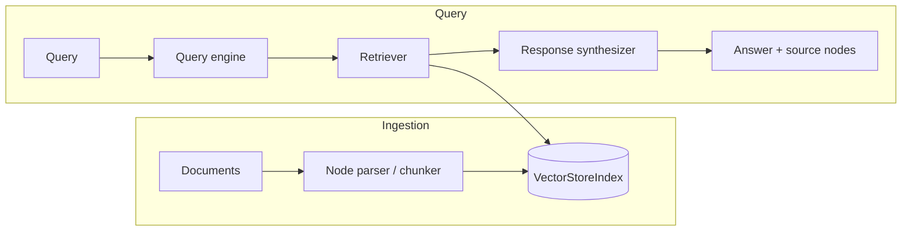

# llamaindex-rag-enterprise

Enterprise-grade Retrieval-Augmented Generation (RAG) service built on LlamaIndex and FastAPI, with Terraform-provisioned cloud infrastructure.

[](LICENSE)
[](https://github.com/abhisheksawant52/llamaindex-rag-enterprise/actions/workflows/ci.yml)
[](https://www.python.org/)
[](https://www.llamaindex.ai/)
[](https://www.terraform.io/)

## Overview

`llamaindex-rag-enterprise` is a production-oriented reference implementation of
a Retrieval-Augmented Generation service. It ingests documents, parses them into
nodes (chunks), embeds and indexes them in a `VectorStoreIndex`, and answers
natural-language queries by retrieving the most relevant nodes and synthesizing
grounded responses with an LLM.

The service is exposed over HTTP with FastAPI and ships with the infrastructure
needed to run it in the cloud: a multi-stage Docker image and a Terraform
configuration that provisions container registry, index storage, logging, and a
managed vector store.

## Architecture



Components:

- **Ingestion pipeline** — loads documents and parses them into nodes with a
  configurable `SentenceSplitter` (chunk size / overlap).
- **VectorStoreIndex** — embeds nodes and stores them for similarity search.
- **Query engine** — combines a retriever (`similarity_top_k`) and a response
  synthesizer to produce grounded answers.
- **RagService** — orchestration layer holding the active index.
- **FastAPI app** — HTTP surface for ingestion and querying.

## Features

- Document ingestion with configurable chunking and node parsing.
- Vector indexing over a pluggable vector store.
- Retrieval + response synthesis with tunable `similarity_top_k`.
- FastAPI service with health/readiness probes and OpenAPI docs.
- Typed configuration via `pydantic-settings` (`LIRAG_` environment prefix).
- Multi-stage, non-root Docker image with a container healthcheck.
- Terraform infrastructure for ECR, S3 index persistence, CloudWatch logs, and a
  managed OpenSearch vector store, with dev/prod environments.

## Tech Stack

Python 3.11+ · FastAPI · Uvicorn · Pydantic v2 · LlamaIndex · OpenAI ·
Terraform (AWS) · Docker · pytest · ruff · black · GitHub Actions

## Getting Started

### Prerequisites

- Python 3.11 or newer
- An OpenAI API key (for embeddings and LLM calls)
- `make` (optional, for convenience targets)

### Install

```bash
python -m venv .venv && source .venv/bin/activate
make install            # pip install -e ".[dev]"
```

### Configure

```bash
cp .env.example .env
# edit .env and set LIRAG_OPENAI_API_KEY
```

### Run

```bash
uvicorn llamaindex_rag.main:app --host 0.0.0.0 --port 8000
```

The API is then available at `http://localhost:8000` with interactive docs at
`http://localhost:8000/docs`.

```bash
# Ingest documents
curl -X POST http://localhost:8000/ingest \
  -H 'content-type: application/json' \
  -d '{"documents":[{"text":"LlamaIndex powers retrieval augmented generation."}]}'

# Query
curl -X POST http://localhost:8000/query \
  -H 'content-type: application/json' \
  -d '{"query":"What does LlamaIndex do?"}'
```

## Project Structure

```
.
├── src/llamaindex_rag/       # application package
│   ├── config.py             # pydantic-settings configuration
│   ├── logging_config.py     # logging setup
│   ├── main.py               # FastAPI app + endpoints
│   ├── models.py             # pydantic request/response models
│   ├── ingestion.py          # document loading + node parsing
│   ├── indexing.py           # VectorStoreIndex build/persist
│   ├── query_engine.py       # retriever + response synthesizer
│   ├── embeddings.py         # embedding provider abstraction
│   ├── vectorstore.py        # vector store abstraction
│   └── service.py            # RagService orchestration
├── terraform/                # AWS infrastructure (IaC)
│   ├── main.tf               # ECR, S3, CloudWatch, module call
│   ├── modules/vector-store/ # OpenSearch vector store module
│   └── environments/         # dev / prod tfvars
├── tests/                    # pytest suite
├── docs/architecture.md      # architecture documentation
└── Dockerfile                # multi-stage, non-root image
```

## Configuration

All settings are read from environment variables prefixed with `LIRAG_`
(see `.env.example`).

| Variable                  | Default                    | Description                              |
| ------------------------- | -------------------------- | ---------------------------------------- |
| `LIRAG_APP_NAME`          | `llamaindex-rag-enterprise`| Application name.                        |
| `LIRAG_ENVIRONMENT`       | `development`              | Deployment environment.                  |
| `LIRAG_LOG_LEVEL`         | `INFO`                     | Logging level.                           |
| `LIRAG_OPENAI_API_KEY`    | _(none)_                   | OpenAI API key.                          |
| `LIRAG_EMBEDDING_MODEL`   | `text-embedding-3-small`   | Embedding model identifier.              |
| `LIRAG_LLM_MODEL`         | `gpt-4o-mini`              | LLM model identifier.                    |
| `LIRAG_VECTOR_STORE_URL`  | `http://localhost:6333`    | Vector store connection URL.             |
| `LIRAG_SIMILARITY_TOP_K`  | `4`                        | Nodes retrieved per query.               |
| `LIRAG_CHUNK_SIZE`        | `1024`                     | Max token size per node.                 |
| `LIRAG_CHUNK_OVERLAP`     | `128`                      | Token overlap between nodes.             |

## Deployment

### Docker

```bash
make docker-build           # docker build -t llamaindex-rag-enterprise:latest .
docker run -p 8000:8000 --env-file .env llamaindex-rag-enterprise:latest
```

The container runs as a non-root user, exposes port `8000`, and includes a
`HEALTHCHECK` against `/health`.

### Terraform

Infrastructure lives under [`terraform/`](terraform/). Provision an environment
with its variable file:

```bash
cd terraform
terraform init
terraform plan  -var-file=environments/dev/terraform.tfvars
terraform apply -var-file=environments/dev/terraform.tfvars
```

Use `environments/prod/terraform.tfvars` for production. The configuration
creates an ECR repository, an S3 bucket for index persistence, a CloudWatch log
group, and a managed OpenSearch vector store (via the `modules/vector-store`
module).

## Contributing

Contributions are welcome — see [CONTRIBUTING.md](CONTRIBUTING.md) and our
[Code of Conduct](CODE_OF_CONDUCT.md).

## Security

Please report vulnerabilities as described in [SECURITY.md](SECURITY.md).

## License

Released under the [MIT License](LICENSE).
