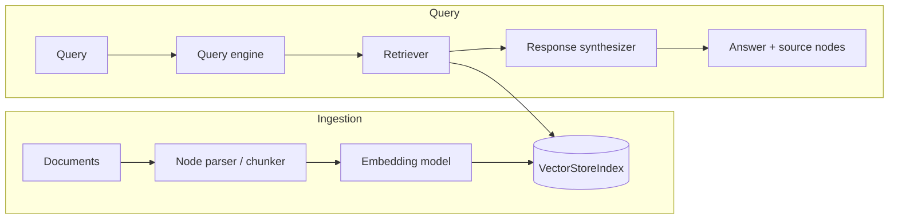

# Architecture

This document describes the architecture of **llamaindex-rag-enterprise**, an
enterprise Retrieval-Augmented Generation (RAG) service built on
[LlamaIndex](https://www.llamaindex.ai/) and [FastAPI](https://fastapi.tiangolo.com/).

## Overview

The service ingests documents, parses them into nodes (chunks), embeds those
nodes, and stores them in a vector index. At query time it retrieves the most
relevant nodes and synthesizes a grounded answer using an LLM.

## Components

- **Ingestion pipeline** (`ingestion.py`) — converts API documents into
  LlamaIndex documents and parses them with a `SentenceSplitter` using the
  configured `chunk_size` and `chunk_overlap`.
- **Indexing** (`indexing.py`) — builds and persists a `VectorStoreIndex` from
  parsed nodes, backed by a configurable storage context.
- **Embeddings** (`embeddings.py`) — provider abstraction that constructs the
  embedding model from settings (OpenAI by default).
- **Vector store** (`vectorstore.py`) — storage-context factory; defaults to an
  in-memory simple store and can be swapped for a networked store.
- **Query engine** (`query_engine.py`) — assembles a retriever + response
  synthesizer with `similarity_top_k` control.
- **Service layer** (`service.py`) — `RagService` orchestrates ingestion,
  indexing, and querying, and holds the active index in memory.
- **API** (`main.py`) — FastAPI app exposing `/health`, `/ready`, `/ingest`,
  `/query`, and `/documents`.

## Configuration

All configuration is provided via environment variables prefixed with
`LIRAG_` and parsed by `pydantic-settings` (see `config.py`). Refer to
`.env.example` for the full list of tunables.

## Deployment

The service ships as a multi-stage Docker image running as a non-root user and
exposing port `8000`. Cloud infrastructure (ECR, S3 index persistence,
CloudWatch logs, and a vector-store module) is provisioned with the Terraform
configuration under [`terraform/`](../terraform/).
